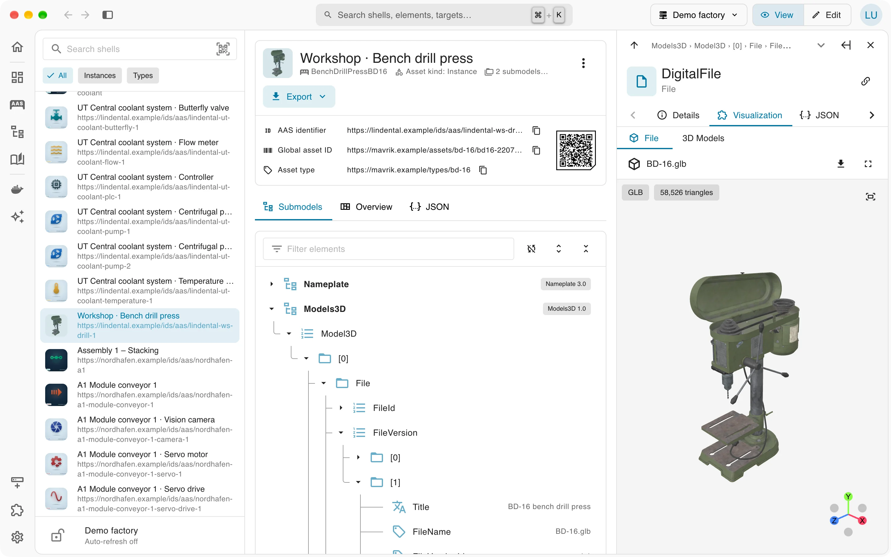
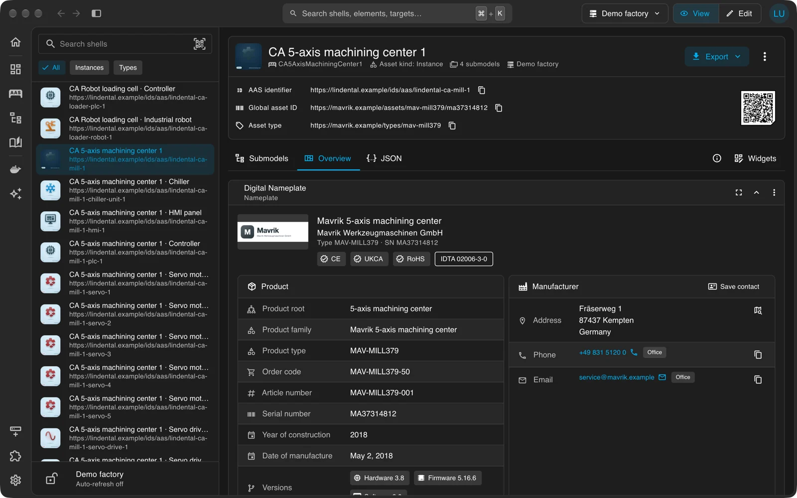
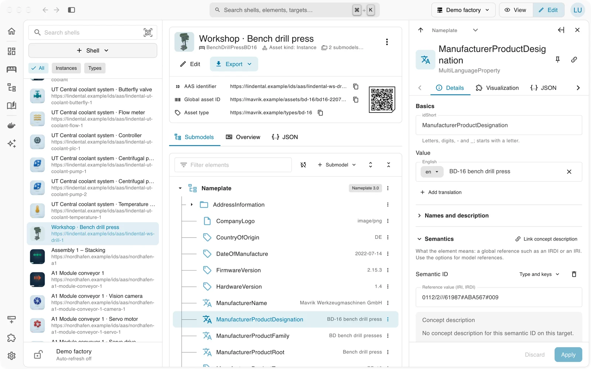

<!-- markdownlint-disable-next-line MD041 -->
<div align="center">
  
  <h1>BaSyx Studio</h1>
  <p><strong>Browse, edit and extend Asset Administration Shells, in the browser or on the desktop.</strong></p>

  <p>
    
    
    <a href="https://github.com/eclipse-basyx/basyx-studio/actions/workflows/ci.yml?query=branch%3Amain"></a>
    <a href="https://github.com/eclipse-basyx/basyx-studio/releases/latest"></a>
    <a href="https://hub.docker.com/r/eclipsebasyx/basyx-studio"></a>
    <a href="LICENSE.md"></a>
  </p>

  <p>
    <a href="#quick-start">Quick start</a> ·
    <a href="docs/README.md">Documentation</a> ·
    <a href="docs/deployment/README.md">Deployment</a> ·
    <a href="packages/studio-sdk/README.md">Build an app</a> ·
    <a href="CONTRIBUTING.md">Contributing</a>
  </p>
</div>

BaSyx Studio is the user interface and authoring environment of
[Eclipse BaSyx](https://eclipse.dev/basyx/) for Asset Administration Shells
(AAS). It works with live AAS servers and with AASX files, and it grows with
apps that you install at runtime or build yourself. Studio is meant to succeed
the [BaSyx AAS Web UI](https://github.com/eclipse-basyx/basyx-aas-web-ui) and
the classic desktop package explorers with one product for end users, AAS
authors and operators of live shells.

> [!WARNING]
> Studio is at an early stage (version 0.x). Expect breaking changes between
> releases, and do not use it in production yet.

<picture>
  <source media="(prefers-color-scheme: dark)" srcset="docs/assets/readme/studio-dark.webp">
  
</picture>

## Features

- **Live AAS infrastructures.** Connect several BaSyx or other AAS v3 servers
  at once, each with its own login. Find shells through registries, discovery
  and query search, then view and edit shells, submodels and concept
  descriptions, and copy shells between infrastructures.
- **AASX files on the desktop.** Open, edit and save AASX packages on your
  computer, several at a time, and start a local BaSyx Go infrastructure on
  Docker or Podman from inside Studio.
- **Apps.** Install apps at runtime to add submodel views, pages and backend
  services. Studio ships with apps for the Digital Nameplate, Technical Data,
  Carbon Footprint, Handover Documentation, bills of material, 3D models,
  time series and more. Packages are signed, and you decide which publishers
  you trust.
- **Your own apps.** Write apps with
  [`@basyx/studio-sdk`](packages/studio-sdk/README.md) and
  `@basyx/studio-app-kit`, or let the [App Builder](docs/app-builder.md) do it:
  in the desktop app, describe the app in a chat, and Claude Code, Codex or
  opencode writes it while Studio shows the result beside the chat.
- **Ready to operate.** One container image with OIDC login, a base path,
  infrastructures declared in configuration, your own branding, a read-only
  mode, and PostgreSQL or an embedded database.
- **Seven languages.** English, German, French, Spanish, Dutch, Japanese and
  Simplified Chinese.

<p>
  
  
</p>

## Quick start

Studio shows the data of an AAS server; it does not include one. Use an
existing server, or start Studio together with BaSyx as described in
[Studio with a BaSyx backend](#studio-with-a-basyx-backend).

### Desktop app

Download the installer for your system from the
[latest release](https://github.com/eclipse-basyx/basyx-studio/releases/latest):

| System | File |
| --- | --- |
| Windows (x64, Arm64) | `BaSyx.Studio-<version>-win-<arch>.exe` |
| macOS (Apple silicon) | `BaSyx.Studio-<version>-mac-arm64.dmg` |
| Linux (x86-64, Arm64) | `BaSyx.Studio-<version>-linux-<arch>.AppImage` |

The installers are not yet signed. On macOS, allow the app under *System
Settings → Privacy & Security* after the first start; on Windows, choose
*More info → Run anyway*.

### Docker

```bash
docker run -p 127.0.0.1:3000:3000 \
  -e STUDIO_PUBLIC_URL=http://localhost:3000 \
  -e STUDIO_DATA_KEY="$(openssl rand -base64 32 | tr '+/' '-_' | tr -d '=')" \
  -e STUDIO_AUTH_MODE=none -e STUDIO_ANONYMOUS_ROLES=studio-admin \
  -e 'STUDIO_APPS_URL=http://{installation}.apps.localhost:3000' \
  -v studio-data:/data \
  eclipsebasyx/basyx-studio:latest
```

Open <http://localhost:3000> and add your AAS server under *Infrastructures*.
`latest` is the newest release; `SNAPSHOT` follows `main`.
This runs Studio without login, so everyone who reaches the port is an
administrator. Apps are served from their own origins under
`apps.localhost`, which browsers resolve to your computer. The
[deployment guide](docs/deployment/README.md) covers login, a base path, the
apps origin, declared infrastructures, branding and Kubernetes.

### Studio with a BaSyx backend

The [quick start example](examples/deployment/quickstart) starts Studio
together with a BaSyx Go AAS environment that is already set up as an
infrastructure:

```bash
git clone https://github.com/eclipse-basyx/basyx-studio.git
cd basyx-studio/examples/deployment/quickstart
cp .env.example .env   # then set STUDIO_DATA_KEY as the file describes
docker compose up -d
```

Open <http://localhost:3000> and import an AASX file, or create a shell; the
bundled apps are installed and show their views. More examples in
[examples/deployment](examples/deployment):

- [production-like](examples/deployment/production-like): Keycloak login,
  PostgreSQL, a reverse proxy and a separate origin for apps
- [time-series](examples/deployment/time-series): InfluxDB with a simulated
  sensor and a Time Series Data submodel
- [http-connections](examples/deployment/http-connections): an app that calls
  an external service through Studio, with a static token or as the signed-in
  user
- [signed-app](examples/deployment/signed-app): a trust store and app
  packages signed with Cosign
- [branding](examples/deployment/branding): a company's name, logos,
  colours, locked settings and legal pages from a branding file

## Develop Studio

You need Node.js 22 or later, Corepack and Docker. The project uses pnpm only.

```bash
corepack enable pnpm
pnpm install --frozen-lockfile
pnpm testenv:up       # local Keycloak and BaSyx Go targets
cp .env.example .env
pnpm dev
```

Sign in at <http://localhost:3000> as `studio-admin` (password `studio-admin`,
test realm only) and register the test targets under *Infrastructures*, as
[test-setup/README.md](test-setup/README.md#targets-for-studio) describes.
Run the checks before you open a pull request:

```bash
pnpm lint
pnpm lint:md
pnpm typecheck
pnpm test
pnpm test:integration   # needs pnpm testenv:up
```

The [setup guide](setup.md) covers the desktop app, the bundled apps, the
container image, end-to-end tests and the supply-chain rules for pnpm.

| Folder | Contents |
| --- | --- |
| [`app/`](app) | Studio's user interface (Nuxt 4, Vue 3, Vuetify) |
| [`server/`](server) | The backend for frontend (Nitro) that talks to AAS servers |
| [`shared/`](shared) | Contracts and code shared by the user interface and the server |
| [`electron/`](electron) | The desktop app |
| [`apps/`](apps) | The apps bundled with Studio |
| [`packages/`](packages) | The SDK, app kit and file viewer published to npm |
| [`examples/`](examples) | Example apps and deployments |
| [`docs/`](docs/README.md) | Requirements, architecture, decisions (ADRs) and guides |

## Documentation

- **Use and run Studio:** [deployment guide](docs/deployment/README.md),
  [App Builder](docs/app-builder.md)
- **Write apps:** [`@basyx/studio-sdk`](packages/studio-sdk/README.md),
  [example apps](examples/apps)
- **Understand Studio:** [architecture overview](docs/architecture/overview.md),
  [deployment variants](docs/architecture/deployment-variants.md),
  [requirements](docs/requirements.md),
  [architecture decision records](docs/adr/README.md)
- **Work on Studio:** [contributing guide](CONTRIBUTING.md),
  [setup guide](setup.md),
  [continuous integration](docs/development/ci.md),
  [design guidelines](docs/development/design-guidelines.md),
  [AGENTS.md](AGENTS.md) for coding agents

The [documentation index](docs/README.md) lists everything.

## Studio in Eclipse BaSyx

Studio uses the [BaSyx TypeScript SDK](https://github.com/eclipse-basyx/basyx-typescript-sdk)
to talk to any server that implements the AAS API v3, including these BaSyx
components:

- [BaSyx Go components](https://github.com/eclipse-basyx/basyx-go-components):
  repositories, registries and discovery in Go
- [BaSyx Java server SDK](https://github.com/eclipse-basyx/basyx-java-server-sdk):
  the same components in Java
- [BaSyx AAS Web UI](https://github.com/eclipse-basyx/basyx-aas-web-ui):
  the web interface that Studio is meant to succeed

The [BaSyx wiki](https://wiki.basyx.org) documents the whole BaSyx stack.

## Contributing

Contributions are welcome. Read [CONTRIBUTING.md](CONTRIBUTING.md) first; in
short:

1. Sign the [Eclipse Contributor Agreement](https://www.eclipse.org/legal/ECA.php)
   with the email address of your commits.
2. Open an issue for larger changes before you write code.
3. Fork the repository, make your change on a branch, and open a pull request.

Ask questions in [GitHub Discussions](https://github.com/eclipse-basyx/basyx-studio/discussions).
Everyone taking part follows the
[Eclipse Foundation Community Code of Conduct](CODE_OF_CONDUCT.md).

## Security

Report vulnerabilities privately as the
[Eclipse BaSyx security policy](https://github.com/eclipse-basyx/.github/blob/main/SECURITY.md)
describes, not in a public issue. Container images are signed keyless with
Cosign and carry SLSA provenance and an SBOM; each GitHub release also attaches
SPDX and CycloneDX files. The deployment guide shows how to
[verify an image](docs/deployment/README.md#image-tags-and-verification).

## License

BaSyx Studio is licensed under the [MIT License](LICENSE.md).
